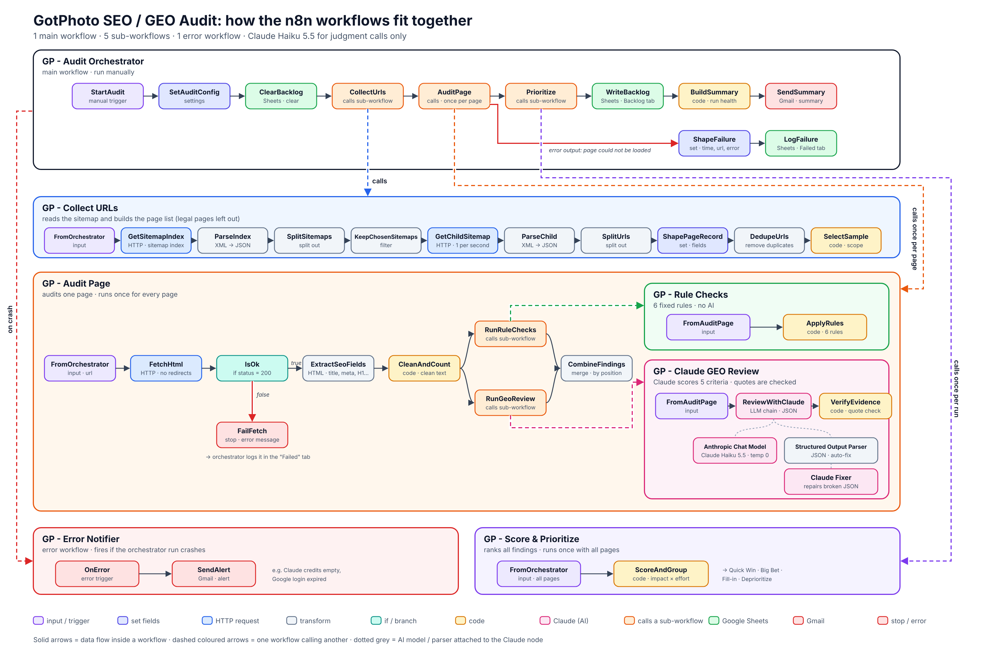

# SEO & GEO Audit Pipeline (n8n + Claude)

An n8n pipeline that audits a company website page by page and turns the results into a **ranked backlog** for a marketing team. Fixed rules handle what can be measured (title length, meta description, H1, …). Claude Haiku 5.5 only handles judgment calls: how well a page would work as a source for AI assistants (**GEO**, Generative Engine Optimization).

I built and tested it on the public website of GotPhoto (gotphoto.com), a software company for volume photographers. This repository contains the tool, not the site-specific results.

**Case study:** [_link to the Notion case study_](https://aminkhalesianprojects.notion.site/Case-Study-SEO-GEO-Audit-Pipeline-in-n8n-with-Claude-3fd5adec5ffb81189b1ed3f74dd9884d)

## What it does

1. **Collect** – reads the website's sitemap and builds the list of pages. Legal pages (data processing agreements, terms, privacy, cookie declaration) are left out on purpose.
2. **Audit each page** – fetches the HTML, extracts the SEO fields, runs 6 fixed rules and a Claude review.
3. **Verify** – every issue Claude reports must quote the page. If the quote is not on the page, the issue is marked `needs_review`.
4. **Prioritize** – ranks all findings by impact and effort into **Quick Win / Big Bet / Fill-in / Deprioritize**. Problems that repeat across the site are grouped into one row.
5. **Report** – writes the backlog to Google Sheets, logs failed pages in their own tab, and sends one summary email with a **run health** check.

## Workflows

| File | Workflow | Job |
|---|---|---|
| `gp-audit-orchestrator.json` | GP - Audit Orchestrator | Main workflow. Settings, clears the sheet, calls the sub-workflows, writes the backlog, sends the email, logs failed pages |
| `gp-collect-urls.json` | GP - Collect URLs | Sitemap index → chosen sitemaps → one record per page, without duplicates and legal pages |
| `gp-audit-page.json` | GP - Audit Page | Runs once per page: fetch, extract, clean, call the two reviews, merge |
| `gp-rule-checks.json` | GP - Rule Checks | 6 fixed SEO rules, no AI |
| `gp-claude-geo-review.json` | GP - Claude GEO Review | Claude scores 5 criteria; quotes are checked against the page |
| `gp-score-and-prioritize.json` | GP - Score & Prioritize | Impact × effort ranking and grouping |
| `gp-error-notifier.json` | GP - Error Notifier | Error workflow: alert email if the whole run crashes |

## The 6 rules

| Rule | Finding | Severity | Label |
|---|---|---|---|
| Title | missing / over 60 chars / under 30 chars | high / medium / low | issue |
| Meta description | missing / over 160 chars / under 70 chars | high / medium / low | issue |
| H1 | missing / more than one | high / medium | issue |
| Canonical | missing / points to another page | medium / low | issue / question |
| Structured data | no JSON-LD | medium | question |
| Images | images with empty alt text | low | issue |

**issue** = clearly something to fix. **question** = may be on purpose; someone from marketing decides.

## The Claude review

Claude scores five criteria from 0 (missing) to 2 (good):

| Criterion | Question |
|---|---|
| `answer_first` | Does the page say right away what it offers and for whom? |
| `specific_facts` | Does it contain concrete, quotable facts (numbers, names, timelines)? |
| `clear_audience` | Is it clear who the page is for? |
| `answers_questions` | Does it answer what a buyer would ask an AI assistant? |
| `fits_purpose` | Does the content match the page's job? |

Safeguards:
- Temperature 0 and a fixed JSON format; a second model repairs broken JSON.
- The page text is marked as **data, not instructions**.
- **Quote check:** every issue must quote the page; quotes are matched ignoring spaces, case, quote and dash styles.
- **Only clear problems** (score 0) become backlog rows. A score of 1 stays in the page's `geo_score` as context.

## Prioritization

- **Impact** = severity (1–3) × page-type weight (page 3, guides 2, success stories 2, blog 1)
- **Effort** = 1–3 per finding type
- **Priority** = impact ÷ effort → Quick Win (high impact, low effort), Big Bet, Fill-in, Deprioritize
- A finding on 3+ pages and at least half of all pages is grouped: a rule finding becomes one **template** row (one fix in the site template), a Claude finding becomes one **pattern** row plus one row per page.

The weights are a first draft, to be agreed with the marketing team.

## Run health

The summary email warns when:
- more than 30% of pages could not be loaded,
- more than 30% of pages got no valid Claude score,
- any Claude quote was not found on its page.

## Setup

Tested with self-hosted n8n 2.35.7.

1. **Import** all 7 JSON files (n8n → Workflows → Import from file).
2. **Credentials:** create an Anthropic credential, a Google Sheets OAuth2 credential and a Gmail OAuth2 credential, and select them in the nodes that use them.
3. **Google Sheet:** create a sheet with two tabs.
   - `Backlog`, row 1: `rank finding source scope pages_affected example_url page_type label owner impact effort priority quadrant detail evidence needs_review`
   - `Failed`, row 1: `run_time url page_type error`
4. **Reconnect the sub-workflows:** in every *Execute Workflow* node (CollectUrls, AuditPage, Prioritize, RunRuleChecks, RunGeoReview), select the matching imported workflow. **Publish** all sub-workflows; a calling workflow uses the published version.
5. **Error workflow:** in GP - Audit Orchestrator → Settings, choose GP - Error Notifier.
6. **Settings:** in `SetAuditConfig`, set the sitemap types, the number of pages per type (`999` = all) and your sheet link. Put your email address in `SendSummary` and `SendAlert`.
7. Set the instance or workflow **timezone**; n8n defaults to New York time.

To audit a different WordPress/Yoast site, change the sitemap URL in `GetSitemapIndex`, the page-type weights in `ScoreAndGroup` and the legal-page list in `SelectSample`.

## Results on the test site

| | Run 1 | Run 2 (after tuning) |
|---|---|---|
| Pages audited | 124 | 113 (legal pages out of scope) |
| Findings | 449 | 174 |
| Claude's "doesn't answer first" flagged on | 97% of pages | 30% |
| Claude quotes not found on the page | 12 | 1 |

Manual spot-check of 12 findings: **rule checks 6/6 correct**; Claude findings 1/6 clearly useful, 2/6 correct but low value, 3/6 wrong (one was a fabricated quote that the quote check had already flagged). Rule findings can go straight into a backlog; Claude findings need human review.

Total API cost for building and running everything: **$0.20**. A full run takes about 10 minutes.

## Known limitations

- The alt-text rule also counts decorative images, where an empty alt is correct.
- Claude judges hub pages and download pages by the same criteria as content pages.
- Scores vary slightly between runs, even at temperature 0.
- Page importance comes from page type, not from traffic data.
- Redirecting URLs are logged as failed (301), not followed.
